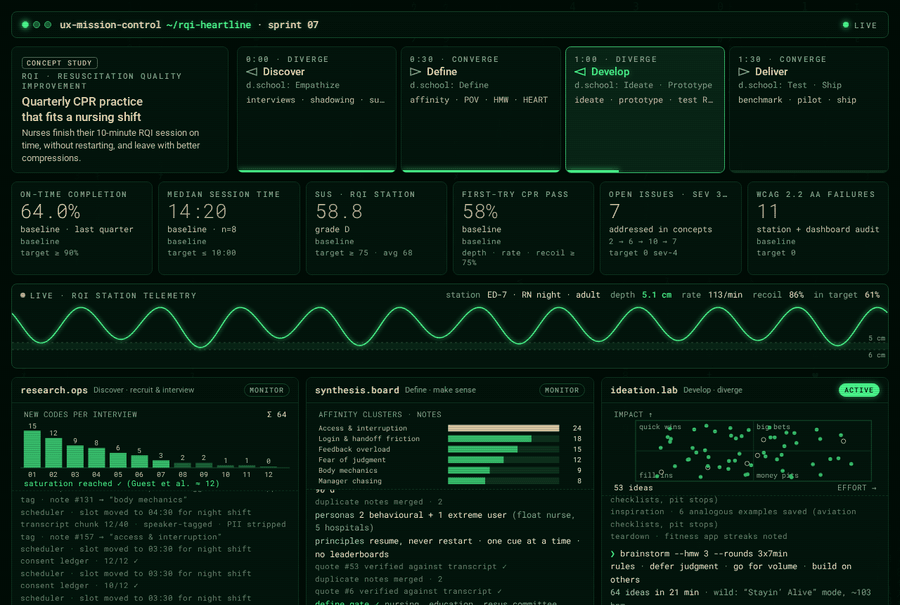
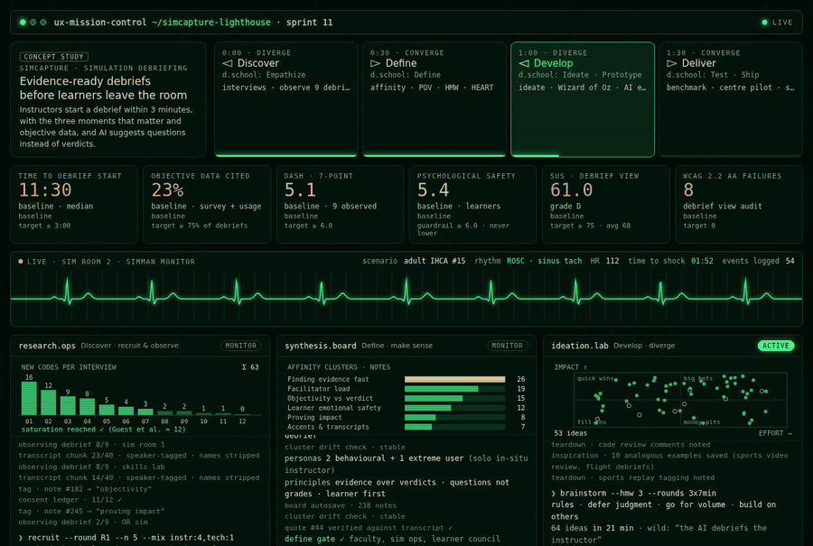

# Puneet Arora — AI Experience Designer & Design Strategist

> Designing intelligent systems at the intersection of human behavior, business outcomes, and ethical AI.  
> Nearly two decades across Dell Technologies, Boeing, HP R&D, and Software AG (IBM).

---

## 🧠 What I Do

I'm a **Principal UX Designer and AI Experience Strategist** based in Bengaluru, India, specializing in **Generative AI product design, AI-driven personalization, responsible AI UX, and enterprise design strategy**.

With **8 USPTO-granted patents and 8 defensive publications**, I've shipped AI-powered products at global scale — from intelligent personalization on Dell.com to risk & fraud detection platforms, smart pricing engines, and digital aviation systems at Boeing.

I also teach **UX Design and Cybersecurity** as guest faculty at design universities and colleges across India, and serve on Boards of Studies shaping the next generation of design curricula.

---

## 🎯 Core Expertise

| Domain | Skills |
|---|---|
| **AI Experience Design** | GenAI UX · Agentic Systems · Responsible AI · AI Guardrails |
| **Design Strategy** | Design Systems · Service Design · Design Ops · UX Maturity |
| **Personalization & CX** | Behavioral Targeting · Recommendation Systems · A/B Experimentation |
| **Design Leadership** | Team Building (31+ designers) · Coaching · AI-ready Talent Development |
| **AI Prototyping & Build** | Claude API · Anthropic SDK · Prompt Engineering · Vanilla JS + IndexedDB |

---

## 🏗️ Featured AI Projects

### [Prompt Intelligence Architect™ by Puneet](https://chatgpt.com/g/g-6a29647fb8a081919ff4d48317565068-prompt-intelligence-architecttm-by-puneet)
Structured prompt design GPT for AI practitioners. Proprietary IP, not a demo — live in the GPT Store.

### [AI-Powered UX Trust & Dark Pattern Intelligence](https://chatgpt.com/g/g-6a284606779881919f6b63bf8855660d-ai-powered-ux-trust-dark-pattern-intelligence)
Behavioral audit GPT that identifies dark patterns, deceptive UX, and trust erosion across digital products. Built around responsible AI design principles.

### [VANTAGE — Strategic Intelligence Engine](https://puneetindeelhi940.github.io/portfolio/ai-lab.html)
Situation-room AI critique tool with 8 analysis modes, Decision Archaeology, Trust Debt Ledger, and an Analyst Corps multi-persona debate model. Direct Anthropic API integration — zero backend.

### [Personal Momentum OS](https://puneetindeelhi940.github.io/portfolio/ai-lab.html)
Local-first intelligence OS with a Meeus panchang engine, Kanban, field-level version history, and SVG export. Single-file HTML, IndexedDB, no cloud dependency.

---

## 🖥️ Live UX Sprint Simulations

Two Laerdal concept studies, each running a full Double Diamond sprint in a 2-minute loop. The project data is simulated; the methods, clinical guidelines and accessibility thresholds are real.

| | Mission Control | Diamond Compiler | Agent Swarm |
|---|---|---|---|
| **RQI**: quarterly CPR practice that fits a nursing shift | [open ▸](https://puneetindeelhi940.github.io/puneetindeelhi940/rqi/mission-control/) | [open ▸](https://puneetindeelhi940.github.io/puneetindeelhi940/rqi/double-diamond-compiler/) | [open ▸](https://puneetindeelhi940.github.io/puneetindeelhi940/rqi/agent-swarm/) |
| **SimCapture**: AI-assisted simulation debriefing | [open ▸](https://puneetindeelhi940.github.io/puneetindeelhi940/simcapture/mission-control/) | [open ▸](https://puneetindeelhi940.github.io/puneetindeelhi940/simcapture/double-diamond-compiler/) | [open ▸](https://puneetindeelhi940.github.io/puneetindeelhi940/simcapture/agent-swarm/) |

<a href="https://puneetindeelhi940.github.io/puneetindeelhi940/rqi/mission-control/"></a>
<a href="https://puneetindeelhi940.github.io/puneetindeelhi940/simcapture/mission-control/"></a>

<sub>Unofficial portfolio concept studies, not affiliated with Laerdal Medical, RQI Partners or the American Heart Association. [All six simulations ▸](https://puneetindeelhi940.github.io/puneetindeelhi940/)</sub>

---

## 🏢 Career Snapshot

```
Dell Technologies  →  Design Lead, AI Personalization + Sr. Manager UX (7y 8m)
Boeing             →  UX Specialist, Digital Aviation (1y 8m)
Software AG / IBM  →  Senior UX Designer, Enterprise Products (1y)
HP R&D             →  Design Engineer II (9y 5m)
```

---

## 🎓 Teaching & Academic Contribution

- **Guest Faculty** — UX Design & Applied AI in Cybersecurity  
  *Amity University, Chitkara Design School, and other institutions*
- **Member, Board of Studies** — Chitkara Design School (2024–2025)  
  Contributed to shaping UX and AI design curriculum at the undergraduate level

---

## 📡 Currently Exploring

- AI Experience Lead & Design Strategist roles (open to global / hybrid / remote)
- Responsible AI UX frameworks and agentic product design patterns
- Building local-first AI tools with direct API integration
- Expanding AI Lab portfolio: [puneetindeelhi940.github.io/portfolio/ai-lab.html](https://puneetindeelhi940.github.io/portfolio/ai-lab.html)

---

## 🔗 Connect

[](https://linkedin.com/in/puneetar)
[](https://puneetindeelhi940.github.io/portfolio/ai-lab.html)
[](mailto:puneetindelhi@yahoo.com)

---

*Keywords: AI UX Designer · Design Strategist · AI Experience Lead · Responsible AI UX · GenAI Product Design · Personalization UX · Design Systems · Human-Centered AI · UX Leadership · 8 USPTO Patents · Bengaluru · India*
